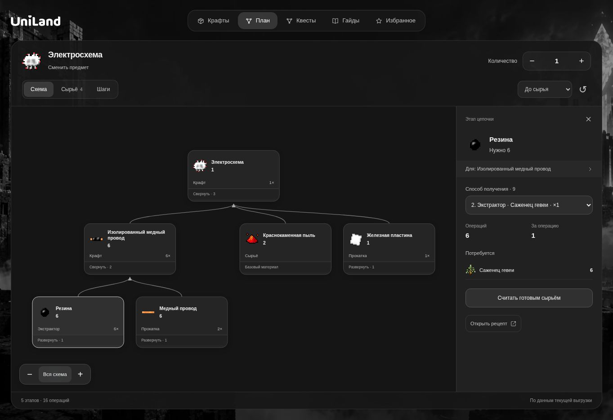
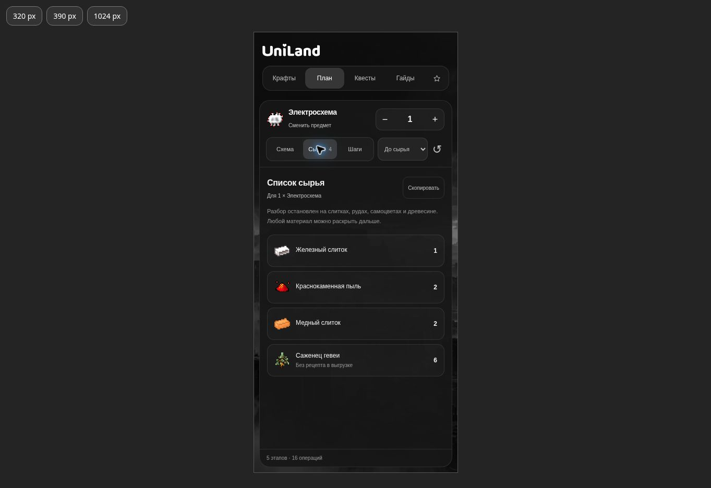
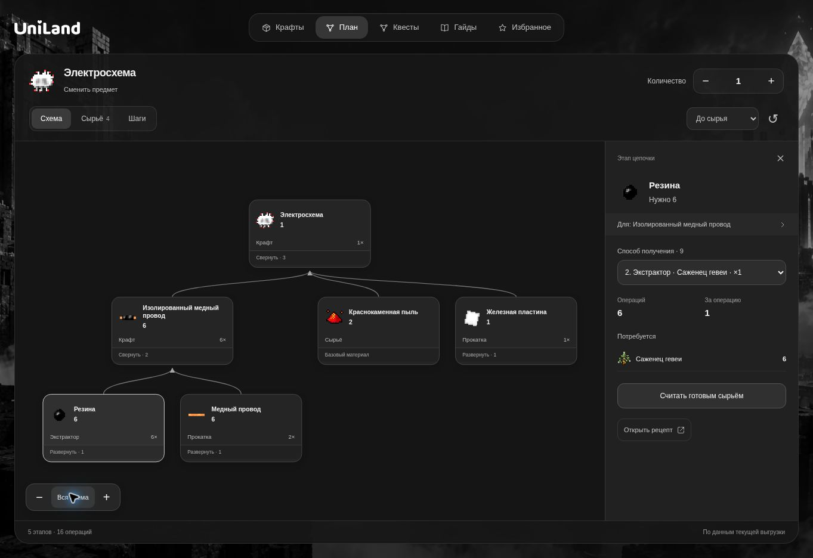

# UniLand: аудит интерфейса и план производства

Проверка: 3 ноября 2026. Область: каталог, поиск, избранное, просмотр рецептов,
карта квестов, библиотека, мобильные панели и новый план производства.
Исходная опубликованная версия: `0558a57f46f1b083d6dacc61dcb5b670768162b6`.

## Вывод

Основные проблемы находились в управлении картой, восстановлении состояния
разделов, стоимости загрузки каталога и пересоздании больших фрагментов UI.
Новая версия использует общий обработчик жестов, облегчённый каталог,
отложенное построение списков альтернатив и расчёт производства в Worker.
Сохранены монохромные панели, фон, спрайты и публикация на GitHub Pages.

## Наблюдения и исправления

| Приоритет | Проблема | Исправление и проверка |
| --- | --- | --- |
| Высокий | Карта квестов не поддерживала полноценный двухпальцевый масштаб; drag мог активировать квест или выделять содержимое | Общий `viewport.js`: Pointer Events, захват указателей, pan/pinch, порог перетаскивания, подавление последующего клика, запрет нативного drag/selection. Проверены 14 сценариев жестов, включая отмену, потерю capture, колесо и resize; реальный drag на узле не открыл квест. |
| Высокий | Полный JSON 56,3 МБ создавал лишнюю работу при старте | Отдельный runtime-каталог 28,8 МБ, общие таблицы вариантов, восстановление ID. Полный исходный каталог и подробности сохранены. Проверено семантическое соответствие всех записей. |
| Высокий | Производственный расчёт большой цепочки мог блокировать интерфейс | Движок выполняется в Web Worker; ответы устаревших запросов отбрасываются, ввод количества объединяется короткой задержкой. Есть явные пределы и продолжение расчёта. |
| Высокий | Каталог мог первым показать служебную запись без входов вместо полноценного рецепта | Рецепты с ингредиентами показываются первыми, остальные сохранены с явным пояснением. У пустых записей нет производственной стрелки. Исправление покрыто регрессией. |
| Высокий | Неполные/специальные рецепты могли дать ложный нулевой расход | Пустые входы, циклы, неясные выходы и ненормализованные механики возвращают отдельные неопределённые потребности. Топливо и справочные свойства не становятся производством. |
| Средний | Повторные входы раздували дерево | Одинаковые входы объединены с сохранением исходных слотов и вариантов. У электросхемы три ветви вместо девяти; сырьё, неопределённости и остатки совпали с исходным расчётом. |
| Средний | Положение карты, фильтры и поиск сбрасывались при переходах | Состояние сохраняется по разделам; карта сохраняет масштаб и центр. Ссылка на квест открывает его главу и показывает узел. |
| Средний | Пустая боковая панель отнимала место у каталога | Неактивная панель скрыта; число карточек пересчитывается по доступным размерам. |
| Средний | Большие наборы альтернатив создавались при каждом открытии рецепта | Ингредиенты создаются при раскрытии, альтернативы добавляются порциями. |
| Средний | Мелкие мобильные элементы и неудобные панели | Увеличены основные области касания, мобильная сетка стала крупнее; детали плана открываются нижней панелью, учитываются safe-area и экранная клавиатура. Узкая ширина не скрывает сброс настроек. |
| Средний | Быстрое закрытие деталей во время перерасчёта могло теряться | Верх панели и кнопка закрытия сохраняют DOM-элемент между обновлениями содержимого. Мобильная панель сохраняет высоту при смене рецепта, поэтому кнопка не уезжает из-под пальца. |
| Средний | Технические имена обработчиков мешали понять машину | В интерфейсе используются человекочитаемые названия известных машин. Исходные идентификаторы в данных не изменены. |
| Средний | Служебная разметка попадала в карточки гайдов | Очищены краткие описания от директив, якорей и управляющих символов; исходные статьи сохранены. |
| Низкий | Тяжёлое размытие больших панелей, слабая читаемость вторичных элементов | Большие панели используют полупрозрачную заливку, размытие осталось на небольших элементах. Повышена читаемость текста, виден фокус клавиатуры и доступна прокрутка длинного содержимого. |

## План производства

1. Открыть предмет и нажать **Рассчитать производство**.
2. Указать нужное количество.
3. В **Схеме** раскрывать ветви, выбирать рецепты/машины и варианты ингредиентов.
4. При необходимости пометить компонент готовым сырьём или разобрать его дальше.
5. В **Сырье** посмотреть суммарную потребность и остатки; список можно скопировать.
6. В **Шагах** посмотреть операции от исходных материалов к готовому предмету.

Движок учитывает размер партии, выход рецепта, общие остатки, однозначные
сопутствующие продукты, единицы и NBT. Альтернативы результата не считаются
одновременными сопутствующими продуктами. Явно заданные катализаторы
учитываются отдельно от расходуемых материалов.

Пример проверки: для одной электросхемы текущий автоматический маршрут требует
1 железный слиток, 2 медных слитка, 2 краснокаменные пыли и 6 саженцев гевеи.
Последнее — результат выбранного в выгрузке рецепта резины, а не рекомендация
добывать её только таким способом. Рецепт и точку остановки можно сменить.
Для 64 электросхем количества масштабировались до 64 / 128 / 128 / 384.

Автоматический маршрут не заявлен глобально оптимальным. Все известные
варианты доступны через выбор в узлах; приложение не строит одновременно
экспоненциальное количество сочетаний альтернатив.

## Данные и производительность

- 25 230 предметов/жидкостей, 30 291 рецептурная запись.
- 989 квестов в 9 главах, 822 материала библиотеки.
- Полный каталог: 56 291 399 байт. Runtime: 28 784 867 байт (−48,9%).
- Контрольное gzip-сжатие: 5 276 874 → 3 924 287 байт (−25,6%).
- SHA-256 `catalog.json` и `current/catalog.json` остался
  `4471042ffc2367bb22ddd8b2df3aec94f80361a2079c2a6a6a96854d9634303c`.
- Числа сжатия — локальные измерения файлов, а не замер сетевого ответа GitHub.
- Изменения памяти измерялись в Node/V8 как сравнительная оценка;
  они не выдаются за результаты на физическом iPhone.

Исходный статус `partial` сохранён. 515 native rules и некоторые специальные
машинные механики ещё не нормализованы полностью. Отсутствие рецепта в
выгрузке не доказывает его отсутствия на сервере.

## Проверка

Проверены реальная база, дерево электросхемы, смена количества, альтернативы,
неопределённый рецепт, список сырья, порядок операций, мобильная карточка,
ширины 320 и 390 px, настольная компоновка, карта квестов и библиотека.
Автоматические проверки: 32 теста расчёта дерева, 14 сценариев жестов,
9 регрессий интерфейса, 20 Python-проверок упаковки/контракта и 3 проверки
сеток рецептов. Все прошли. Синтаксис всех семи JS-файлов проверен.
Проверочная полная сборка: 25 462 файла, около 733 МБ; все ссылки проверены.

Тесты и команды воспроизводятся из [README](README.md) и запускаются в
[GitHub Actions](.github/workflows/pages.yml). Физические мобильные устройства
в этой среде не использовались; мобильная компоновка проверялась в браузерном
окне соответствующей ширины, а multi-touch — тестами Pointer Events.

## Визуальные материалы до изменений

- [Каталог](audit-before-catalog.jpg)
- [Квесты](audit-before-quests.jpg)
- [Мобильные квесты](audit-before-mobile.jpg)

## Итоговый интерфейс

## Проверка публикации

На [GitHub Pages](https://un1nova.github.io/UniLand/) проверены загрузка
25 230 предметов, поиск электросхемы, построение дерева в Worker, раскрытие
ветвей и выбор рецептов. Модули загружены по ожидаемым хешированным адресам,
ошибок приложения в консоли не было.

